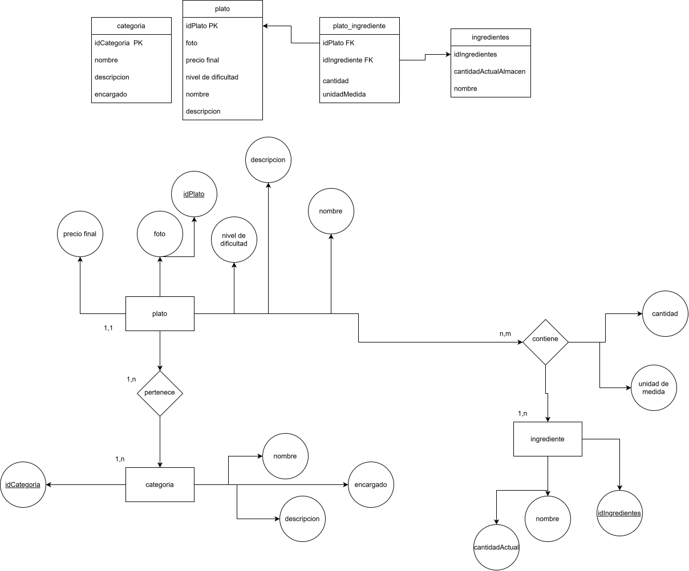

# Sistema de Gestión de Platos e Ingredientes

A continuación se detalla el diseño de la base de datos para la gestión del menú, categorías e ingredientes.

## 1. Modelo Relacional (Tablas)

| categoria |
| :--- |
| **idCategoria (PK)** |
| nombre |
| descripcion |
| encargado |

| plato |
| :--- |
| **idPlato (PK)** |
| foto |
| precio final |
| nivel de dificultad |
| nombre |
| descripcion |

| plato_ingrediente |
| :--- |
| *idPlato (FK)* |
| *idIngrediente (FK)* |
| cantidad |
| unidadMedida |

| ingredientes |
| :--- |
| **idIngredientes (PK)** |
| cantidadActualAlmacen |
| nombre |

---

## 2. Modelo Entidad-Relación (Diagrama)



---


## 4. Implementación en MySQL (Código SQL)

A continuación se detalla el script de creación de tablas (`DDL`) optimizado para MySQL. Se definen tipos de datos específicos, restricciones de integridad y la tabla de unión necesaria para la relación Muchos a Muchos (`M:N`).

```sql
CREATE DATABASE IF NOT EXISTS gestion_restaurante;
USE gestion_restaurante;

-- 1. Crear tabla CATEGORIA (Entidad fuerte)
CREATE TABLE categoria (
    idCategoria INT AUTO_INCREMENT,
    nombre VARCHAR(100) NOT NULL,
    descripcion TEXT,
    encargado VARCHAR(100),
    PRIMARY KEY (idCategoria)
) ENGINE=InnoDB;

-- 2. Crear tabla PLATO (Entidad fuerte con FK a Categoria)
CREATE TABLE plato (
    idPlato INT AUTO_INCREMENT,
    nombre VARCHAR(150) NOT NULL,
    descripcion TEXT,
    precio_final DECIMAL(6,2) NOT NULL, -- Permite precios hasta 9999.99
    nivel_de_dificultad VARCHAR(50),
    foto VARCHAR(255), -- Almacena la ruta o URL de la imagen
    idCategoria INT NOT NULL,
    PRIMARY KEY (idPlato),
    FOREIGN KEY (idCategoria) REFERENCES categoria(idCategoria)
        ON DELETE RESTRICT ON UPDATE CASCADE
) ENGINE=InnoDB;

-- 3. Crear tabla INGREDIENTES (Entidad fuerte)
CREATE TABLE ingredientes (
    idIngredientes INT AUTO_INCREMENT,
    nombre VARCHAR(100) NOT NULL,
    cantidadActualAlmacen DECIMAL(8,2) NOT NULL, -- Soporta decimales para kilos, litros, etc.
    PRIMARY KEY (idIngredientes)
) ENGINE=InnoDB;

-- 4. Crear tabla PLATO_INGREDIENTE (Tabla intermedia M:N)
CREATE TABLE plato_ingrediente (
    idPlato INT,
    idIngrediente INT,
    cantidad DECIMAL(6,2) NOT NULL,
    unidadMedida VARCHAR(20) NOT NULL, -- Ej: 'g', 'ml', 'unidades'
    PRIMARY KEY (idPlato, idIngrediente), -- Clave primaria compuesta
    FOREIGN KEY (idPlato) REFERENCES plato(idPlato)
        ON DELETE CASCADE ON UPDATE CASCADE,
    FOREIGN KEY (idIngrediente) REFERENCES ingredientes(idIngredientes)
        ON DELETE RESTRICT ON UPDATE CASCADE
) ENGINE=InnoDB;
```

### Explicación Técnica de las Decisiones de Diseño:
*   **`DECIMAL(6,2)` para Precios:** En lugar de usar `FLOAT` o `DOUBLE` (que pueden causar errores de redondeo), se utiliza `DECIMAL` para garantizar una precisión matemática exacta en aspectos financieros.
*   **Clave Primaria Compuesta:** En la tabla intermedia `plato_ingrediente`, la combinación de `idPlato` e `idIngrediente` actúa como clave primaria única para evitar que se repita la misma combinación en el sistema.
*   **Políticas de Borrado (`ON DELETE`):**
    *   Si se elimina un `plato`, se eliminan automáticamente sus registros vinculados en `plato_ingrediente` (`CASCADE`).
    *   No se permite eliminar una `categoria` ni un `ingrediente` si existen platos o recetas que dependan de ellos (`RESTRICT`), protegiendo la integridad de los datos.


## 3. Reglas de Negocio y Cardinalidades
*   **Plato - Categoría (1:N):** Un plato **pertenece** obligatoriamente a una única categoría (1,1), mientras que una categoría puede englobar a uno o muchos platos (1,n).
*   **Plato - Ingrediente (M:N):** Un plato **contiene** muchos ingredientes y un ingrediente puede formar parte de muchos platos (n,m). 
*   **Atributos de Relación:** Los atributos `cantidad` y `unidad de medida` se sitúan en la relación de intersección (`contiene`), ya que dependen de la combinación específica de un plato y un ingrediente concreto.
